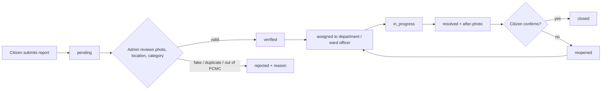

# Hyperlocal Civic Issue Reporter (PCMC)

A MERN-stack platform where citizens of the **Pimpri-Chinchwad Municipal Corporation (PCMC)** area report civic problems with a **photo and map location**, and PCMC staff **verify, assign and resolve** them. Everything is tracked publicly so nobody has to wonder what happened to their complaint.

**Issues covered:** drainage overflow, water-logging / stagnant water on roads, garbage dumps in public places, potholes and road damage, water leakage, broken streetlights, and more.

> This README is the implementation plan. It extends the product spec in `project.md`.

---

## 1. Goals

- Make reporting take under a minute: take a photo, drop a pin, pick a category, submit.
- Give every report a visible status so citizens can track it.
- Give admins a **verification queue** so fake, duplicate or out-of-area reports are filtered before work is assigned.
- Show where problems cluster by ward (map and analytics).

## 2. Tech Stack

| Layer | Choice | Why |
|---|---|---|
| Frontend | React (Vite), React Router, Axios, Tailwind CSS | Fast dev, simple routing |
| Maps | Leaflet + OpenStreetMap | Free, no API key |
| Backend | Node.js, Express | REST API |
| Database | MongoDB Atlas + Mongoose | Flexible schema, `2dsphere` geospatial queries |
| Image storage | Cloudinary (via `multer`) | Free tier, resizing, CDN URLs |
| Auth | JWT + bcrypt, role-based middleware | Simple and standard |
| Validation | `zod` or `express-validator` | Safe input |
| Security | `helmet`, `cors`, `express-rate-limit`, `express-mongo-sanitize` | Baseline hardening |
| Testing | Jest, Supertest, `mongodb-memory-server` | API tests without a real DB |
| Deployment | Vercel (client), Render/Railway (server), Atlas (DB) | Free tiers available |

## 3. User Roles

| Role | Can do |
|---|---|
| **Citizen** | Register/login, report issues with photos, upvote existing issues, comment, track own reports |
| **Admin** (PCMC staff) | See the verification queue, verify or reject reports, assign, update status, upload resolution photo |
| **Super admin** | Everything above, plus manage categories, wards and admin accounts |

Citizens can never change status. Roles are enforced on the server, not just hidden in the UI.

## 4. Issue Lifecycle (verification workflow)



**Statuses:** `pending` → `verified` → `assigned` → `in_progress` → `resolved` → `closed`, plus `rejected` and `reopened`.

**Verification rules for admins:**
1. The photo clearly shows the reported problem.
2. The pin is inside PCMC limits and roughly matches the photo.
3. The category is correct (admin may change it).
4. It is not a duplicate. If it is, merge it into the original and keep the upvote.
5. Rejection **requires a reason**, which the citizen can see.

Every status change is stored in `statusHistory` with who changed it, when, and a note.

## 5. Features

### Citizen
- Sign up and log in (email + password for MVP).
- **Report an issue in 3 steps:**
  1. Upload 1 to 3 photos (compressed in the browser before upload).
  2. Pin the location on the map (or use device GPS).
  3. Choose category, add a short description, submit.
- Ward is detected automatically from the pin.
- **Duplicate warning:** if an open issue of the same category exists within about 50 m, suggest upvoting it instead.
- Map and list of issues with filters (category, status, ward).
- Upvote, comment, and "My reports" page with the status timeline.

### Admin
- **Verification queue** sorted by priority and age.
- Issue detail view with photos, map, history, and verify / reject / assign actions.
- Filter by ward, category, status, date.
- Upload a resolution photo when marking resolved.
- Dashboard: counts by status, by category, by ward, average resolution time, SLA breaches.

## 6. Data Models (Mongoose)

```js
// User
{ name, email (unique), passwordHash, role: 'citizen'|'admin'|'superadmin',
  ward (admin only, optional), isActive, createdAt }

// Category
{ name, slug, icon, defaultPriority: 'low'|'medium'|'high',
  slaDays, department }

// Ward
{ name, number, boundary: { type: 'MultiPolygon', coordinates } }   // 2dsphere index

// Issue
{
  title, description,
  category: ObjectId -> Category,
  reporter: ObjectId -> User,
  ward: ObjectId -> Ward,
  location: { type: 'Point', coordinates: [lng, lat] },             // 2dsphere index
  address: String,                                                  // optional landmark text
  images: [{ url, publicId }],
  resolutionImages: [{ url, publicId }],
  status: 'pending'|'verified'|'rejected'|'assigned'|'in_progress'|'resolved'|'closed'|'reopened',
  rejectionReason: String,
  priority: 'low'|'medium'|'high',
  upvotes: [ObjectId -> User], upvoteCount: Number,
  assignedTo: ObjectId -> User,
  statusHistory: [{ status, changedBy, note, at }],
  dueDate, resolvedAt, createdAt, updatedAt
}

// Comment
{ issue, user, text, createdAt }
```

**Indexes:** `Issue.location` (2dsphere), `Ward.boundary` (2dsphere), `Issue` on `{ status, ward, category, createdAt }`, `User.email` (unique).

## 7. API Design

Base URL: `/api`. Protected routes expect `Authorization: Bearer <token>`.

### Auth
| Method | Route | Access |
|---|---|---|
| POST | `/auth/register` | Public |
| POST | `/auth/login` | Public |
| GET | `/auth/me` | Logged in |

### Issues
| Method | Route | Access | Notes |
|---|---|---|---|
| POST | `/issues` | Citizen | `multipart/form-data` with images |
| GET | `/issues` | Public | Filters: `status, category, ward, page, limit, sort` |
| GET | `/issues/nearby?lng=&lat=&radius=` | Public | Map view and duplicate check |
| GET | `/issues/mine` | Citizen | Own reports |
| GET | `/issues/:id` | Public | Full detail and history |
| PATCH | `/issues/:id/verify` | Admin | Moves `pending` to `verified` |
| PATCH | `/issues/:id/reject` | Admin | Body: `reason` (required) |
| PATCH | `/issues/:id/assign` | Admin | Body: `assignedTo` |
| PATCH | `/issues/:id/status` | Admin | `in_progress`, `resolved` (needs after-photo) |
| POST | `/issues/:id/confirm` | Reporter | Confirm fixed or reopen |
| POST | `/issues/:id/upvote` | Citizen | Toggle |
| POST | `/issues/:id/comments` | Logged in | |
| GET | `/issues/:id/comments` | Public | |

### Admin and reference data
| Method | Route | Access |
|---|---|---|
| GET | `/admin/queue` | Admin (pending issues) |
| GET | `/admin/stats` | Admin |
| GET | `/categories` | Public |
| POST/PUT/DELETE | `/categories` | Super admin |
| GET | `/wards` | Public |

All errors return `{ success: false, message }` with a proper status code (400, 401, 403, 404, 409).

## 8. Image Upload Flow

1. Client compresses each image (about 1280 px max side, JPEG/WebP) with `browser-image-compression`.
2. Client sends `multipart/form-data` to `POST /api/issues`.
3. Server uses `multer` (memory storage) with limits: **max 3 files, 5 MB each, only jpeg/png/webp**.
4. Server streams the files to Cloudinary and stores `{ url, publicId }` on the issue.
5. If the DB save fails afterward, delete the uploaded Cloudinary images (no orphans).
6. When an issue is deleted or rejected-and-purged, delete its images by `publicId`.

## 9. Ward Detection and Duplicate Check

- **Ward:** query `Ward.findOne({ boundary: { $geoIntersects: { $geometry: point } } })`. If no ward matches, the pin is outside PCMC and the request is rejected with a clear message.
- **Duplicate:** query open issues of the same category within 50 m using `$near` / `$geoWithin`, and return them to the client before final submit.
- **Ward boundary data:** needs a PCMC ward GeoJSON. Source it from PCMC open data or OpenStreetMap and verify it before relying on it. For development, start with a few rough polygons.

## 10. Priority and SLA

- Start from the category's `defaultPriority` (for example drainage overflow = high, minor road wear = low).
- Raise priority automatically when `upvoteCount` crosses thresholds (for example 5 and 15).
- `dueDate = verifiedAt + category.slaDays`. A scheduled job (`node-cron`) flags overdue issues for the admin dashboard.

## 11. Folder Structure

```
hyperlocal_civic_issue/
├── README.md
├── project.md
├── client/                      # React (Vite)
│   └── src/
│       ├── api/                 # axios instance, API calls
│       ├── components/          # Navbar, IssueCard, MapView, ImageUploader, StatusBadge
│       ├── context/             # AuthContext
│       ├── pages/
│       │   ├── Home.jsx         # map + list
│       │   ├── Login.jsx / Register.jsx
│       │   ├── ReportIssue.jsx
│       │   ├── IssueDetail.jsx
│       │   ├── MyReports.jsx
│       │   └── admin/           # Dashboard, VerificationQueue, IssueManage
│       ├── routes/              # ProtectedRoute, AdminRoute
│       └── main.jsx
├── server/
│   ├── config/                  # db.js, cloudinary.js
│   ├── models/                  # User, Category, Ward, Issue, Comment
│   ├── controllers/
│   ├── routes/
│   ├── middleware/              # auth, role, upload, validate, errorHandler
│   ├── utils/                   # wardLookup, duplicateCheck, priority
│   ├── seed/                    # categories.js, wards.js, admin.js
│   ├── tests/
│   └── server.js
└── shared/                      # constants shared by client and server (statuses, roles)
```

## 12. Implementation Plan

Rough timeline for a small student team. Adjust to your sprint length.

### Phase 0: Setup (1 to 2 days)
- [ ] Create `client/` (Vite + React + Tailwind) and `server/` (Express).
- [ ] Set up MongoDB Atlas, Cloudinary account, `.env` files, ESLint/Prettier.
- [ ] Branch strategy: `main` (stable), `dev`, and one feature branch per task.

### Phase 1: Backend foundation (3 to 4 days)
- [ ] DB connection, error handler, `notFound` middleware.
- [ ] `User` model, register/login, JWT, `protect` and `authorize(...roles)` middleware.
- [ ] Seed script: categories, one super admin, sample wards.
- [ ] Tests for auth.

### Phase 2: Issues and image upload (4 to 5 days)
- [ ] `Category`, `Ward`, `Issue` models with geospatial indexes.
- [ ] `multer` + Cloudinary upload middleware.
- [ ] `POST /issues` with ward detection, duplicate check, status history entry.
- [ ] `GET /issues` (filters, pagination), `/issues/nearby`, `/issues/:id`, `/issues/mine`.
- [ ] Upvote and comments.

### Phase 3: Admin verification (3 to 4 days)
- [ ] `/admin/queue`, verify, reject (reason required), assign, status update.
- [ ] Enforce valid status transitions in one place (a transition map), so a `pending` issue cannot jump to `resolved`.
- [ ] Resolution photo upload, `resolvedAt`, citizen confirm/reopen.
- [ ] `/admin/stats` aggregations (by status, category, ward, average resolution time).

### Phase 3.5: Quick manual API test
- [ ] Walk the full lifecycle in Postman: register, report with image, admin verifies, assign, resolve, citizen confirms.

### Phase 4: Citizen frontend (5 to 6 days)
- [ ] Auth pages, `AuthContext`, protected routes.
- [ ] Home: Leaflet map with markers (colored by status) plus filterable list.
- [ ] Report flow: image uploader with preview, map pin picker, geolocation button, duplicate suggestion step.
- [ ] Issue detail with photos, timeline, upvote, comments.
- [ ] My Reports page.

### Phase 5: Admin frontend (4 to 5 days)
- [ ] Admin route guard and layout.
- [ ] Verification queue with quick verify / reject (reason modal).
- [ ] Issue management page: assign, update status, upload after-photo.
- [ ] Dashboard charts (status split, category split, per-ward counts).

### Phase 6: Polish, testing, deploy (3 to 4 days)
- [ ] Loading and error states, mobile responsiveness (most reporters will use phones).
- [ ] Security pass: `helmet`, rate limiting on auth and report endpoints, input sanitization.
- [ ] Backend tests (Jest + Supertest) for auth, create issue, verification transitions, permissions.
- [ ] Deploy: client on Vercel, server on Render/Railway, set env vars and CORS origin.
- [ ] Record a demo and add screenshots to this README.

## 13. Environment Variables

**server/.env**
```
PORT=5000
MONGO_URI=mongodb+srv://<user>:<pass>@<cluster>.mongodb.net/civic_db
JWT_SECRET=<long-random-string>
JWT_EXPIRES_IN=7d
CLIENT_URL=http://localhost:5173
CLOUDINARY_CLOUD_NAME=
CLOUDINARY_API_KEY=
CLOUDINARY_API_SECRET=
```

**client/.env**
```
VITE_API_URL=http://localhost:5000/api
```

Never commit `.env` files.

## 14. Security and Privacy Checklist

- [ ] Passwords hashed with bcrypt; never returned in responses.
- [ ] Role checks on every admin route, on the server.
- [ ] Validate and sanitize all input; reject unexpected fields.
- [ ] Check file type and size server-side, not only in the browser.
- [ ] Rate-limit login and report creation to reduce spam.
- [ ] Public responses show only the reporter's first name or "Anonymous", never email or phone.
- [ ] Short JWT lifetime; consider httpOnly cookies for production.

## 15. Testing Checklist

- [ ] Citizen cannot call admin routes (403).
- [ ] Pin outside PCMC is rejected.
- [ ] Upload over 5 MB or wrong file type is rejected.
- [ ] Rejecting without a reason fails.
- [ ] Invalid status jumps are blocked.
- [ ] Duplicate nearby issue is suggested.
- [ ] Works on a real phone: camera capture, GPS, small screens.

## 16. Future Scope

- Email and in-app notifications on status changes (Socket.io for live updates).
- Heatmap of problem hotspots by ward.
- OTP-based phone login.
- AI photo categorization to suggest the category automatically.
- WhatsApp reporting bot.
- Marathi, Hindi and English interface.
- Integration with PCMC's official grievance system if an API becomes available.
- Field-agent role with proof photos.

## 17. Getting Started (once code exists)

```bash
git clone https://github.com/AmanMahadik/hyperlocal_civic_issue.git
cd hyperlocal_civic_issue

# server
cd server && npm install && cp .env.example .env && npm run seed && npm run dev

# client (new terminal)
cd client && npm install && npm run dev
```
